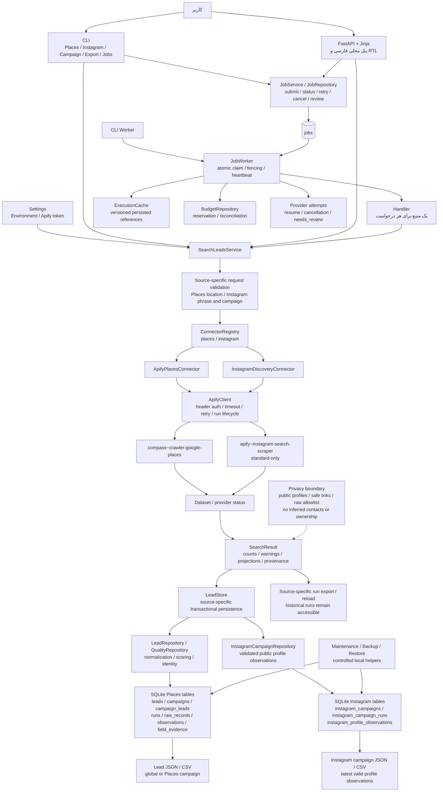
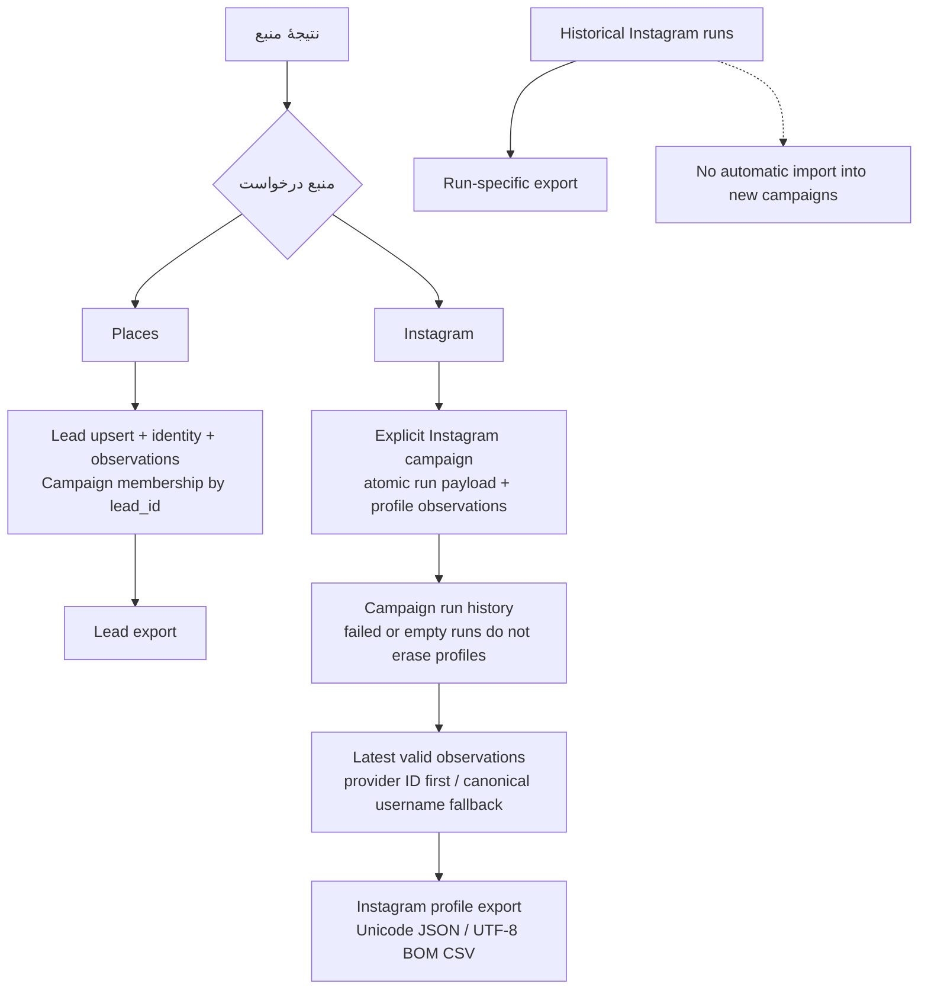

# معماری

## معماری فعلی — 2026-10-12

این نمودار وضعیت اجرایی فعلی را نشان می‌دهد، نه قابلیت‌های تاریخی. فقط `places` و جست‌وجوی مستقل `instagram` فعال‌اند و هر درخواست دقیقاً یک منبع انتخاب می‌کند. Google Search، LinkedIn، TikTok، YouTube و enrichment چندمنبعی جزو محصول فعال نیستند.

Instagram فقط در حالت standard با `liveSearch=false` و enhancement غیرفعال اجرا می‌شود: یک عبارت بدون ویرگول، limit پیش‌فرض ۱۰ و بازهٔ ۱ تا ۲۵۰. Campaign اینستاگرام باید صریحاً انتخاب شود و با Campaign لیدهای Places مشترک نیست. نتیجهٔ جست‌وجو تضمین جغرافیایی یا تأیید کسب‌وکار نیست.

## نمودار اجزا و جریان داده

همهٔ جدول‌های نمایش‌داده‌شده در یک SQLite محلی نگهداری می‌شوند؛ جداسازی در نمودار **منطقی** است، نه دو دیتابیس یا دو سرویس مستقل. CLI مستقیماً از service استفاده می‌کند؛ API وب واسطهٔ اجباری CLI نیست. ثبت Job نیز به‌تنهایی Worker ایجاد یا اجرا نمی‌کند.

## منطق ذخیره‌سازی و خروجی

- Places و Instagram schema خروجی مستقل دارند؛ پروفایل Instagram به Lead کسب‌وکار تبدیل یا با آن ادغام نمی‌شود.
- هویت پروفایل ابتدا بر مبنای provider ID و سپس username canonical است؛ جدیدترین observation معتبر با ترتیب `(started_at, run_id)` انتخاب می‌شود.
- Run موفق replay‌شده نمی‌تواند به Campaign دیگری منتقل شود؛ Runهای failed/empty در تاریخچه باقی می‌مانند و پروفایل‌های قبلی را حذف نمی‌کنند.
- دادهٔ Instagram شامل فیلدهای عمومی پروفایل و لینک‌های امن است؛ از biography شماره تماس یا مالکیت استنتاج نمی‌شود.
- CSV از formula injection محافظت می‌شود. ذخیرهٔ تاریخی به معنی فعال‌بودن sourceهای حذف‌شده نیست.

## اجرا و محدودیت‌ها

- Worker از claim اتمیک، fencing، heartbeat، provider attempt و resume استفاده می‌کند. نتیجهٔ نامعلوم provider می‌تواند به `needs_review` نیاز داشته باشد؛ این سازوکار تضمین عمومی exactly-once در سرویس خارجی نیست.
- Cache، budget و maintenance اجزای داخلی محلی‌اند؛ در نمودار queue خارجی یا daemon خودکار فرض نشده است.
- authentication و دسترسی شبکه‌ای از این نمودار نتیجه نمی‌شوند؛ پنل برای اجرای محلی طراحی شده است.
- اجرای پولی Actor و certification حالت live در این به‌روزرسانی انجام نشده است.

## مراجع implementation

- [Registry](../src/registry.py)، [Service](../src/service.py) و [Request models](../src/search_requests.py)
- [Connectorها](../src/connectors/)، [Apify client](../src/apify.py) و [Execution](../src/execution/)
- [Storage](../src/storage.py)، [Instagram campaigns](../src/instagram_campaigns.py) و [Migrations](../src/migrations.py)
- [عملیات](02-operations-guide.md)، [مدل داده](05-data-model.md) و [قرارداد Apify](06-apify-integration.md)
