# معماری

## وضعیت hardening فعلی

SQLite منبع اصلی محلی است. Jobها با claim اتمیک، fencing و heartbeat اجرا می‌شوند؛ cache فقط با mapper/policy version و referenceهای پایدار replay می‌شود؛ identity index و campaign `lead_id` در migrationهای افزایشی فعال‌اند؛ merge/undo snapshot ممیزی دارد؛ backup/restore و maintenance به‌صورت helperهای کنترل‌شده ارائه می‌شوند. lifecycle کامل provider و حذف نهایی کلید legacy campaign هنوز در حال تکمیل است.

این سند snapshot معماری اجرایی فعلی پروژه است؛ یعنی علاوه بر مسیر قدیمی synchronous، مسیر Job/Worker، انتخاب چندمنبع، کنترل هزینه و بازبینی پروفایل عمومی را نیز نشان می‌دهد. وضعیت قابلیت‌ها باید با `ConnectorRegistry.capabilities()` و contract gateها هماهنگ بماند.

## نمودار معماری و جریان داده

```mermaid
flowchart LR
    USER["کاربر"] --> CLI["CLI<br/>search / campaign / export"]
    BROWSER["مرورگر محلی"] --> WEB["FastAPI + Jinja<br/>RTL / localhost-only"]
    ENV["Environment<br/>APIFY_API_TOKEN + settings"] --> CFG["Settings"]
    CLI --> CFG
    WEB --> CFG

    CLI --> SVC["SearchLeadsService<br/>هم‌زمان و سازگار با مسیر قدیمی"]
    WEB --> SVC
    SVC --> REG["ConnectorRegistry<br/>capabilities + select_sources"]
    REG --> PLACES["Places Connector<br/>فعال"]
    REG --> GSEARCH["Google Search Connector<br/>فعال برای مسیرهای پشتیبانی‌شده"]
    REG -.-> SOCIAL["Instagram / TikTok / YouTube<br/>contract gate: blocked"]

    PLACES --> APIFY["ApifyClient<br/>header auth / timeout / retry"]
    GSEARCH --> APIFY
    APIFY --> ACTORS["Apify Actors"]
    ACTORS --> DATASET["Dataset / run status"]
    DATASET --> RESULT["SearchResult<br/>status + provenance + allowlisted raw"]
    RESULT --> PIPE["normalization<br/>validation / scoring / identity matching"]
    PIPE --> PERSIST["persist_search_result<br/>transactional"]

    SVC --> ORCH["MultiSourceOrchestrator<br/>partial outcome"]
    ORCH --> RESULT

    WEB --> JOBAPI["Job API<br/>submit / status / retry / cancel"]
    CLI --> JOBAPI
    JOBAPI --> JOBSVC["JobService"]
    JOBSVC --> JOBDB[(jobs)]
    JOBSVC --> WORKER["JobWorker<br/>lease + fencing token"]
    WORKER --> HANDLERS["handlers<br/>places / multi-source"]
    HANDLERS --> SVC
    WORKER --> CACHE["ExecutionCache"]
    WORKER --> BUDGET["BudgetRepository<br/>reserve / reconcile"]
    CACHE --> JOBDB
    BUDGET --> JOBDB

    PERSIST --> DB[(SQLite)]
    DB --> TABLES["leads / campaigns / campaign_leads (campaign_id, lead_id)<br/>runs / raw_records / observations<br/>field_evidence / profiles / jobs / provider_attempts / budget"]
    DB --> EXPORT["Exporters"]
    EXPORT --> JSON["JSON"]
    EXPORT --> CSV["CSV"]

    GSEARCH --> ENRICH["Enrichment<br/>public profile candidates"]
    ENRICH --> PROFILES["ProfileRepository<br/>explicit review + evidence"]
    PROFILES --> REVIEW["Web profile review page"]

    SVC -.-> FAIL["Failed Run<br/>no lead/raw persistence"]
    FAIL --> DB
    PRIV["Privacy boundary<br/>public professional business data only<br/>no owner inference"] -.-> RESULT
    PRIV -.-> RAWPOLICY["raw allowlist / export"]
```



### تفسیر مسیرهای اصلی

1. **جست‌وجوی هم‌زمان:** CLI یا Web UI ورودی query، location، source، limit و Campaign را به `SearchLeadsService` می‌دهد. سرویس منبع را قبل از ساخت Connector اعتبارسنجی می‌کند، Actor را اجرا می‌کند، رکوردها را به `SearchResult` و سپس به Lead استاندارد تبدیل می‌کند و نتیجه را در یک تراکنش SQLite ذخیره می‌کند.
2. **چندمنبعی:** `select_sources()` انتخاب را اتمیک و پیش از اجرای Actor اعتبارسنجی می‌کند. `MultiSourceOrchestrator` هر منبع را مستقل اجرا می‌کند و وضعیت `succeeded`، `partial` یا `failed` و گام‌های موفق را حفظ می‌کند؛ شکست یک منبع نتیجهٔ منابع موفق را حذف نمی‌کند.
3. **Job/Worker:** APIهای `/api/jobs` و `/api/orchestrated-searches` درخواست را با `idempotency_key` در `jobs` ثبت می‌کنند. Worker با lease و fencing token یک Job را claim می‌کند، handler مناسب را اجرا می‌کند، progress و provider run را ثبت می‌کند و برای failure/partial/cancel وضعیت نهایی می‌سازد. retry از مسیر API یک کلید جدید ایجاد می‌کند.
4. **کنترل هزینه و تکرارپذیری:** Worker در صورت وجود `estimated_cost` از `BudgetRepository` reservation می‌گیرد و پس از اجرا reconcile می‌کند. `ExecutionCache` برای درخواست‌های قابل cache استفاده می‌شود؛ `force_refresh` آن را دور می‌زند.
5. **غنی‌سازی محافظه‌کارانه:** Google Search می‌تواند فقط کاندیدای پروفایل عمومی HTTPS را پیدا کند. شهر، دامنهٔ رسمی و evidence برای confidence به‌کار می‌روند؛ تطبیق نهایی و review صریح در `ProfileRepository` انجام می‌شود و مالکیت شخصی هرگز استنتاج نمی‌شود.
6. **خروجی:** Exporter از Leadهای ذخیره‌شده، به‌صورت سراسری یا محدود به Campaign، JSON یا CSV می‌سازد و مسیرهای مقصد تو‌در‌تو را ایجاد می‌کند.

### مسیر خطا، امنیت و حریم خصوصی

خطاهای credential، timeout/network، endpoint/Actor ناموجود، پاسخ malformed و dataset نامعتبر به‌عنوان failure ثبت می‌شوند و برای Run شکست‌خورده Lead یا raw record جدید ذخیره نمی‌شود. توکن فقط از Environment خوانده و در Header به Apify ارسال می‌شود؛ در URL، log، metadata و export قرار نمی‌گیرد. raw payload با allowlist محدود است. فقط دادهٔ عمومی و حرفه‌ای مرتبط با کسب‌وکار مجاز است و دادهٔ reviewer/owner یا استنتاج مالکیت خارج از scope است.

## جریان دادهٔ خلاصه

```text
CLI/Web -> Settings -> Service -> Registry -> Connector -> Apify Actor
       -> SearchResult -> normalize/validate/score/match -> SQLite
       -> Campaign membership + provenance + run/raw metadata -> JSON/CSV

Web/CLI -> JobService -> jobs -> JobWorker -> handler -> Service
                         -> lease/fencing + cache + budget + progress

Lead + Google Search candidates -> evidence/confidence -> explicit profile review
```

## اجزا و مرزها

- **CLI (`src/cli.py`):** validation، dispatch و نمایش خلاصه؛ منطق scraping و persistence در CLI نیست.
- **Web (`src/web/`):** routeهای Dashboard، Campaign، search، export، Job و profile review؛ فارسی/RTL و local-only. routeها از service/repository استفاده می‌کنند و نباید Actor را مستقیم صدا بزنند.
- **Service و orchestration (`src/service.py`, `src/orchestration.py`):** lifecycle جست‌وجو، failure recording، انتخاب منبع و حفظ نتیجهٔ partial.
- **Execution (`src/execution/`):** `JobService`، `JobRepository`، Worker، handlerها، lease/fencing، cache و budget reservation.
- **Registry و connectorها (`src/registry.py`, `src/connectors/`):** قرارداد source، descriptor قابلیت‌ها، validation و اتصال Places/Google Search؛ social connectorها تا عبور contract gate غیرفعال‌اند.
- **Domain و quality (`src/domain.py`, `src/quality/`):** Lead، normalization، validation، scoring، dedup/matching، provenance و profile evidence.
- **Apify (`src/apify.py`):** احراز هویت امن، timeout، retry محدود، اجرای Actor، دریافت dataset و طبقه‌بندی خطا.
- **Persistence (`src/migrations.py`, `src/storage.py`, `src/repositories.py`):** migration نسخه‌دار و transaction-based SQLite، repositoryهای Lead/Campaign/Run و سازگاری `LeadStore`.
- **Export (`src/exporters.py`):** JSON/CSV iterator-based، حالت extended برای provenance و محافظت CSV در برابر formula injection.

## تصمیم‌های طراحی و وضعیت قابلیت‌ها

- Apify پشت Connector پنهان است و token فقط از Environment می‌آید.
- Actor ID در URL API با `~` نوشته می‌شود و Places با `waitForFinish=60` اجرا می‌شود.
- هر record منبع و provenance دارد؛ raw فقط با allowlist ذخیره می‌شود.
- API Job idempotent است؛ lifecycle آن queued/running/succeeded/partial/failed/cancelled است.
- `places` فعال است؛ `google_search` در مسیرهای پشتیبانی‌شده استفاده می‌شود؛ Instagram، TikTok، YouTube و هر source فاقد contract gate فعال، blocked باقی می‌مانند.
- Web UI روی `127.0.0.1` است و در MVP احراز هویت، چندکاربره‌بودن و queue بیرونی ندارد؛ Worker فعلی یک abstraction قابل اتصال به اجرای بیرونی است.

## توسعهٔ آینده

فعال‌سازی social source فقط پس از تأیید هم‌زمان schema ورودی، privacy و pricing در contract gate مجاز است. هر connector جدید باید قرارداد `SearchResult`، provenance، failure classification، budget behavior و تست‌های آفلاین را رعایت کند. توسعهٔ profile matching باید evidence-based بماند و هرگز از نام یا قرائن برای استنتاج مالکیت استفاده نکند.
