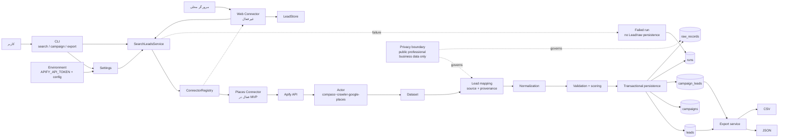

# معماری

## نمودار معماری و جریان داده



### تفسیر مسیر اصلی

1. CLI ورودی query، location، source، limit و Campaign را می‌گیرد و تنظیمات را از Environment می‌خواند.
2. `SearchLeadsService` اجرای use case را به `ConnectorRegistry` می‌سپارد؛ در MVP فقط Places فعال است.
3. Connector از طریق Apify Actor اجرا می‌شود، dataset را می‌خواند و رکوردها را با حفظ source/provenance به `Lead` نگاشت می‌کند.
4. normalization، validation و scoring قبل از یک تراکنش SQLite انجام می‌شوند.
5. هر Lead در `leads` یکتا نگه داشته می‌شود و عضویت آن در Campaignها در `campaign_leads` ثبت می‌شود؛ metadata، run و raw record نیز جدا ذخیره می‌شوند.
6. Export از وضعیت فعلی Leadها، به‌صورت سراسری یا محدود به Campaign، JSON یا CSV تولید می‌کند.

### مسیر خطا و مرز حریم خصوصی

خطاهای credential، timeout/network، پاسخ malformed و dataset نامعتبر به‌عنوان `Run` ناموفق ثبت می‌شوند؛ برای Run شکست‌خورده Lead یا raw record ذخیره نمی‌شود. توکن فقط در Header احراز هویت Apify استفاده می‌شود و هرگز در URL، log یا metadata قرار نمی‌گیرد. همهٔ داده‌ها باید عمومی و حرفه‌ای و مرتبط با کسب‌وکار باشند.

## جریان داده

```text
CLI -> Settings -> Connector -> Apify Actor -> Dataset
    -> Lead mapping -> normalize -> score -> SQLite -> JSON/CSV
```

## اجزا

- CLI: اعتبارسنجی ورودی و نمایش نتیجه؛ بدون orchestration یا scraping logic.
- Web UI: رابط فارسی/RTL برای Dashboard، Campaign، جست‌وجوی Places و export؛ بدون SQL مستقیم یا اتصال مستقیم به Apify.
- `SearchLeadsService`: اجرای use case، lifecycle اجرا، ذخیره لید و metadata.
- `ConnectorRegistry`: انتخاب منبع؛ در MVP فقط `places` فعال است و `web` غیرفعال است.
- Connector: اجرای منبع و برگرداندن `SearchResult` شامل leads، status، provenance و raw records محدود.
- Domain: مدل `Lead`، نرمال‌سازی، validation، امتیازدهی و تطبیق هویت.
- Storage: migration نسخه‌دار SQLite، repositoryها، upsert و export.
- Apify client: authentication امن، timeout، retry محدود و دریافت Actor/dataset.

## تصمیم‌های طراحی

- Apify پشت Connector پنهان است.
- token فقط از Environment خوانده می‌شود.
- Actor ID در URL API با `~` نوشته می‌شود.
- اجرای Places با `waitForFinish=60` انجام می‌شود.
- منبع هر رکورد با `source` مشخص می‌شود.

## توسعه آینده

Connectorهای Instagram، TikTok و YouTube باید همین قرارداد را پیاده کنند. تطبیق social profile باید امتیاز و evidence داشته باشد و صرفاً بر اساس نام ادغام نشود.
